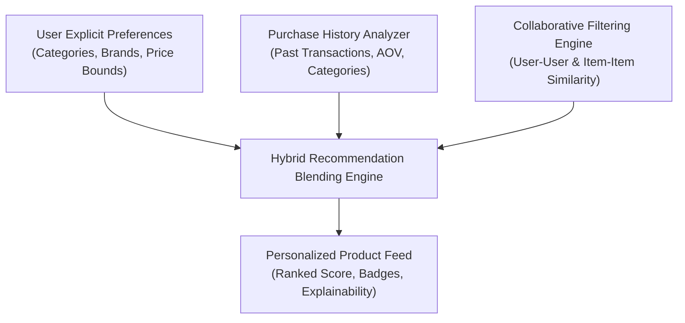

# 🛍️ AI Product Recommendation Engine

[](https://console.cron-job.org/jobs)
[](https://legion0069.github.io/Automation/)
[](https://github.com/legion0069/AI-Product-Recommendation-Engine/actions)
[](https://legion0069.github.io/Automation/)

> **Autonomous AI-Driven E-Commerce Personalization Engine**: Recommends products based on user preferences, analyzes transaction purchase history, implements collaborative filtering (user-user and item-item similarity), and delivers hyper-personalized product recommendations with explainable AI rationales.

---

## 🎯 Core Capabilities

1. **User Preference Profiler**: Captures explicit category choices, brand affinities, and price elasticity thresholds.
2. **Purchase History Analyzer**: Mines historical order logs, calculates repeat purchase frequency, Customer Lifetime Value (CLV), and category affinities.
3. **Collaborative Filtering**: Evaluates User-User Pearson correlation and Item-Item cosine similarity matrices to predict unrated products from nearest neighbors.
4. **Personalized Recommendations**: Combines collaborative filtering, content-based matching, and purchase history into a weighted hybrid ensemble with explainability badges (`🔥 Best Match for You`, `⭐ High Compatibility`).



---

## ⏰ Daily Automation Schedule (cron-job.org)

To bypass GitHub Actions scheduling queue delays, this repository uses an external trigger configured via **[cron-job.org](https://console.cron-job.org/jobs)**:

- **Schedule**: **Daily at 11:00 AM IST (11:00 IST / 05:30 UTC)**
- **Target Endpoint**: `https://api.github.com/repos/legion0069/AI-Product-Recommendation-Engine/actions/workflows/daily-streak.yml/dispatches`
- **Method**: `POST`
- **Payload**: `{"ref": "main"}`
- **Frequency**: 5 commits executed daily across 30 days.

---

## 🗺️ 30-Day Master Milestone Roadmap

### Phase 1: Foundation & Data Modeling (Days 1–5)
- [x] **Day 1**: Project Setup, Architecture & Recommendation Domain Schemas
- [x] **Day 2**: Product Catalog Repository & Multidimensional Tagging Store
- [ ] **Day 3**: User Preference Profiler & Explicit Interest Matrix
- [ ] **Day 4**: Purchase History Analyzer & Transaction Ledger Ingestion
- [ ] **Day 5**: Sparse Interaction Matrix Builder & Rating Normalizer

### Phase 2: Core Recommendation Algorithms (Days 6–11)
- [ ] **Day 6**: User-Based Collaborative Filtering (User-User Cosine & Pearson)
- [ ] **Day 7**: Item-Based Collaborative Filtering (Item-Item Adjusted Cosine)
- [ ] **Day 8**: Matrix Factorization & Latent Factor Decomposition (SVD / ALS)
- [ ] **Day 9**: Content-Based Filtering & Product Feature Vector Extraction
- [ ] **Day 10**: Hybrid Recommendation Blending Engine (Weighted Multi-Model Ensemble)
- [ ] **Day 11**: Cold-Start Onboarding Strategy & Popularity Fallback Engine

### Phase 3: Advanced Personalization & Real-Time Intelligence (Days 12–17)
- [ ] **Day 12**: Real-Time Session-Based Recommender & Short-Term Intent Tracker
- [ ] **Day 13**: Implicit Feedback Processor (Clicks, Views, Cart Additions & Dwell Time)
- [ ] **Day 14**: Dynamic Re-Ranking, Novelty Boost & Filter-Bubble Mitigator
- [ ] **Day 15**: Context-Aware Recommendations (Temporal, Seasonal & Device Context)
- [ ] **Day 16**: Market Basket Analysis & Frequently Bought Together (Apriori Engine)
- [ ] **Day 17**: Personalized Promotion Affinity & Price Sensitivity Matcher

### Phase 4: Evaluation, Metrics & Explainability (Days 18–22)
- [ ] **Day 18**: Recommendation Evaluation Suite (Precision@K, Recall@K, MAP & NDCG)
- [ ] **Day 19**: Explainable AI Recommendation Layer ('Why Recommended for You')
- [ ] **Day 20**: A/B Testing Framework & Multi-Armed Bandit Exploration Engine
- [ ] **Day 21**: User Negative Signal & Dislike Feedback Loop Processor
- [ ] **Day 22**: High-Speed Vector Similarity Search & Index Optimization

### Phase 5: API & Interactive Web Dashboard (Days 23–27)
- [ ] **Day 23**: REST API Routing Layer (/recommendations/user, /similar, /preferences)
- [ ] **Day 24**: Interactive Web UI: Personalized Storefront & Dynamic Product Shelves
- [ ] **Day 25**: Interactive Web UI: User Preference Center & Purchase History Timeline
- [ ] **Day 26**: Interactive Web UI: Collaborative Filtering Live Visualizer & Similarity Graph
- [ ] **Day 27**: Admin Analytics Dashboard: Click-Through Rates, Conversion Lift & Algorithm Benchmarks

### Phase 6: Integration, Security & Production Release (Days 28–30)
- [ ] **Day 28**: End-to-End Recommendation Pipeline Integration & Stress Testing
- [ ] **Day 29**: Data Privacy Compliance, Anonymization & High-Throughput Cache Layer
- [ ] **Day 30**: Production Packaging, Comprehensive User Guide & v1.0.0 Release

---

## 🚀 Quick Start

### Installation
```bash
git clone https://github.com/legion0069/AI-Product-Recommendation-Engine.git
cd AI-Product-Recommendation-Engine
npm install
```

### Run Recommendation Workflow Demo
```bash
npm start
```

### Run Automated Test Suites
```bash
npm test
```

### Run Daily Streak Generator Manually
```bash
npm run streak
```

---

## 🏛️ Project Architecture

```
AI-Product-Recommendation-Engine/
├── .github/
│   └── workflows/
│       └── daily-streak.yml               # GitHub Actions workflow (11:00 AM IST)
├── .gitstreak/
│   └── state.json                         # 30-Day progress state & milestone tracker
├── docs/
│   ├── milestones/                        # Daily completion records
│   └── specs/                             # Architectural specifications
├── scripts/
│   └── streak-runner.js                   # Autonomous 5-commit streak generator
├── src/
│   ├── models/
│   │   ├── Product.js                     # Product catalog entity
│   │   └── User.js                        # User profile, preferences & purchases
│   ├── engine/
│   │   ├── CollaborativeFiltering.js      # User-User & Item-Item collaborative filtering
│   │   ├── ContentBasedFilter.js          # Product feature token & attribute matching
│   │   ├── PurchaseHistoryAnalyzer.js     # Transaction ledger analytics & category affinity
│   │   └── HybridRecommender.js           # Multi-model weighted ensemble blender
│   └── cli.js                             # Interactive CLI demonstration
├── tests/
│   └── recommendationEngine.test.js       # Automated unit & integration tests
├── package.json
└── README.md
```

---

## 📜 License
Licensed under the [MIT License](LICENSE).
